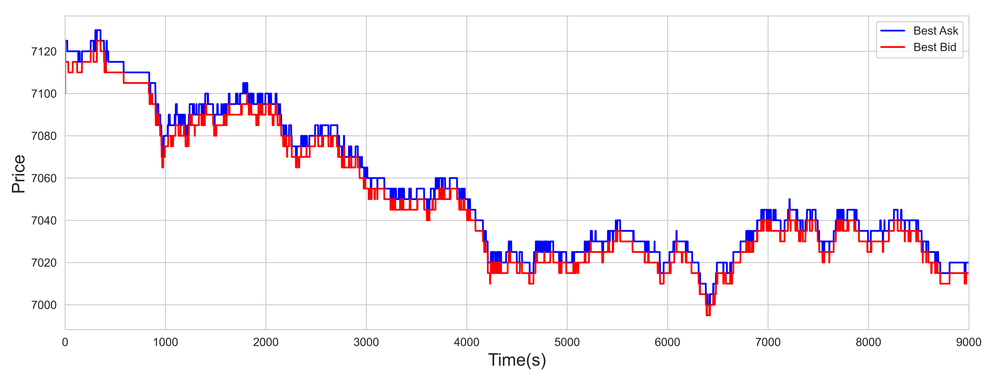
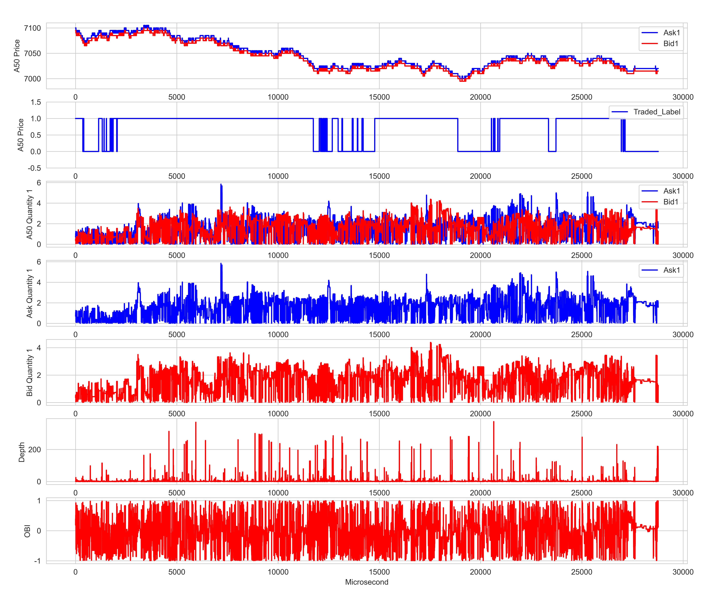
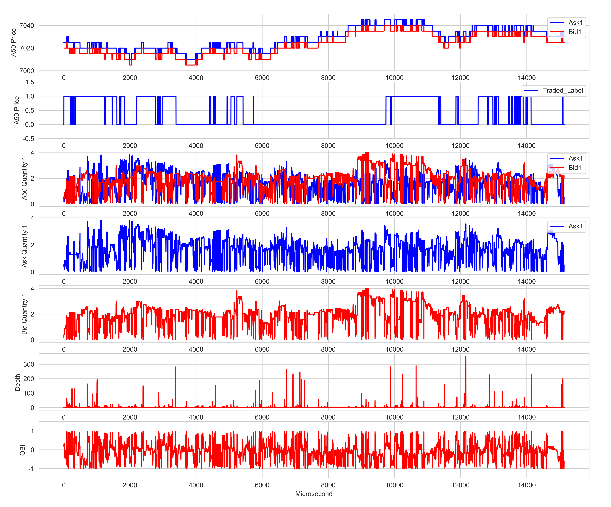
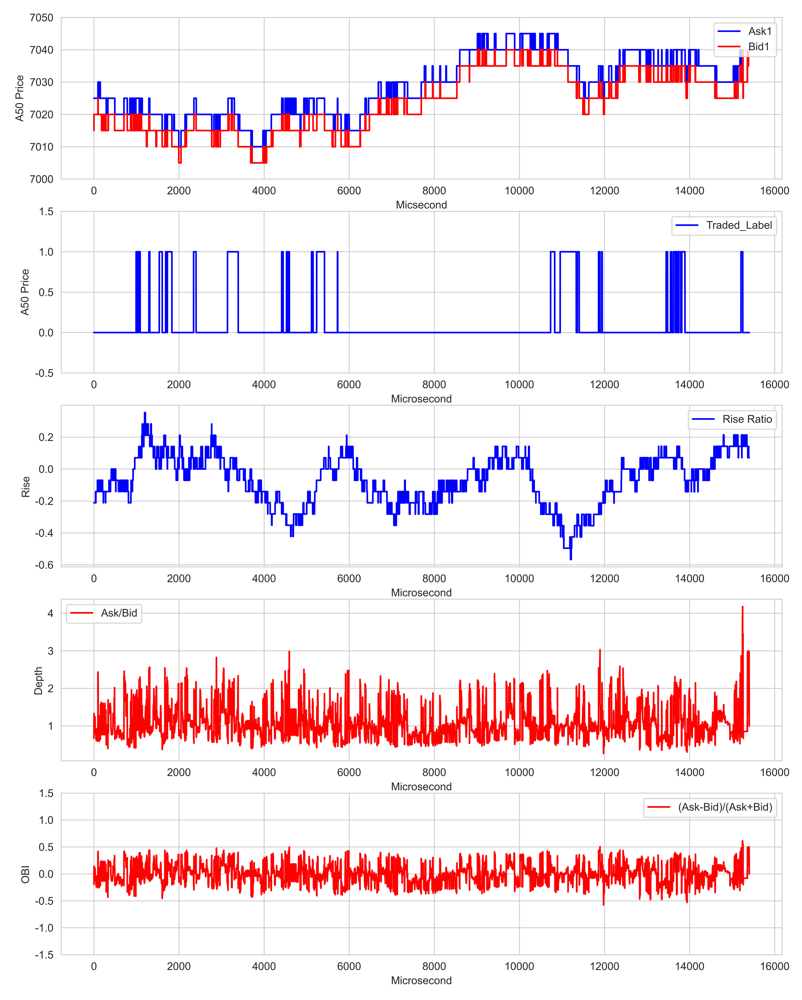
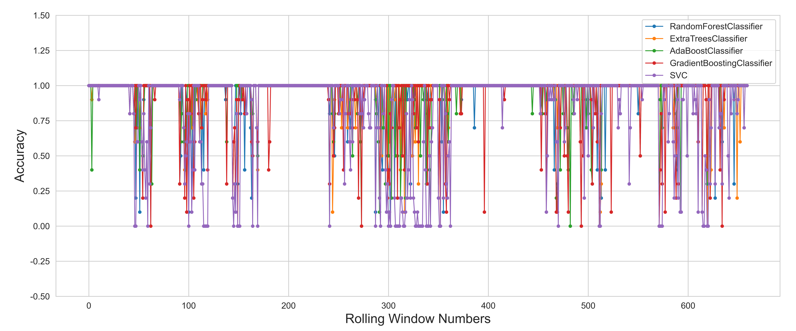
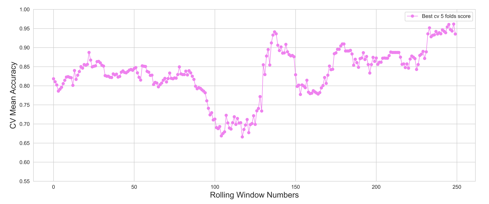
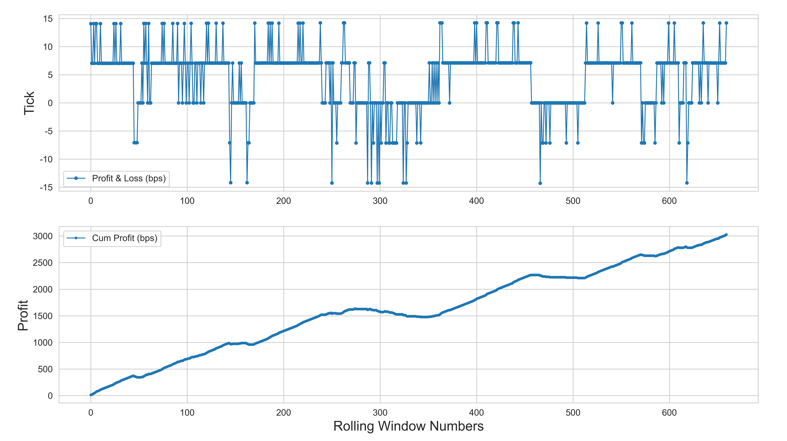

# 📈 High-Frequency Trading Framework with Machine/Deep Learning

A framework for exploring high-frequency trading using machine learning and deep learning techniques on Level-II limit order book data. The project covers market microstructure signals, feature engineering, predictive modeling, and trading performance visualization.

## 🎯 Project Objectives

- Extract trading signals from Level-II order book data.
- Investigate short-term order book dynamics using machine learning.
- Explore market microstructure features for predictive modeling.
- Analyze model performance and visualize prediction results.

## 📊 Dataset

The project uses tick-level depth data from SGX FTSE China A50 Index Futures, a major Asia-Pacific index futures contract traded on the Singapore Exchange.

The included data represents historical market observations rather than a live trading feed.

## 🔄 Strategy Pipeline

The framework follows a pipeline from order book data processing and feature construction to model fitting, prediction analysis, and performance visualization.

  

## 📉 Order Book Signals

The framework explores market microstructure features, including:

- **Depth Ratio:** Examines liquidity distribution across order book levels.
- **Rise Ratio:** Captures price-related changes in the order book.
- **Order Book Imbalance (OBI):** Measures differences between bid-side and ask-side quantities.

  

## 📈 Price Series

The original price-series visualization illustrates the best bid and ask prices over time.

  

## 🧰 Feature Engineering & HFT Factors Design

### Simple Average Depth Ratio and OBI

The following plots illustrate order book features across different market sessions.

  

  

### Weighted Average Depth Ratio, OBI, and Rise Ratio

  

## 🤖 Model Fitting

### Baseline Models

The original framework explores the following classification approaches:

- Random Forest Classifier
- Extra Trees Classifier
- AdaBoost Classifier
- Gradient Boosting Classifier
- Support Vector Machines
- Other potential classifiers and architectures, including Softmax, KNN, MLP, and LSTM

### Experimental Configuration

- **Training window:** 30 minutes
- **Test window:** 10 seconds
- **Prediction label:** 15-minute forward horizon

These are the experimental settings documented by the original project.

## 📊 Performance Metrics and Original Results

The following figures preserve the original project's prediction and model-evaluation visualizations. They are reproduced from the existing repository and are not independently verified results from new experiments.

### Prediction Accuracy

  

### Prediction Accuracy Series

  

### Cross-Validation Mean Accuracy

  

### Best Model

  

## 💹 P&L Visualization

The original repository includes the following visualization associated with its model evaluation and P&L analysis.

  

**Evaluation note:** Predictive accuracy alone does not establish trading profitability. Transaction costs, commissions, slippage, market impact, look-ahead bias, and out-of-sample performance must be considered before drawing conclusions about a strategy's viability.

## 💡 Potential Improvements

The original project identifies several possible research directions.

### Feature Engineering

- Volume imbalance and trade imbalance signals.
- Technical indicators derived from bid and ask price series, including RSI and MACD.
- Weighted average price, VWAP, TWAP, and related price features.
- Alternative weighting schemes across order book levels.
- Moving averages and weighted combinations of trading signals.
- Feature selection and methods such as Lasso regression and genetic programming.

### Models

Potential extensions include:

- CNN and GRU/LSTM architectures.
- XGBoost, LightGBM, and other gradient-boosting approaches.
- Attention-based models and autoencoders.
- TabNet and pretrained models.

### Performance Evaluation

- More robust P&L calculations.
- Explicit commission and transaction-cost modeling.
- Time-aware validation and out-of-sample testing.
- Evaluation across different market periods and conditions.

## 👩‍💻 My Contribution and Learning Focus

As an IIT Delhi Production and Industrial Engineering student interested in machine learning and quantitative finance, I use this project to study the intersection of market microstructure, feature engineering, and predictive modeling.

My focus areas include:

- Understanding how Level-II order book data can be transformed into quantitative features.
- Studying the relationship between liquidity imbalance, price dynamics, and prediction targets.
- Examining the experimental workflow from data preprocessing to model evaluation.
- Identifying opportunities to improve evaluation rigor, reproducibility, and transaction-cost-aware strategy analysis.

**Scope clarification:** The original implementation and results are retained for attribution and reference. The points above describe my learning and analysis focus, not a claim that every proposed improvement has already been implemented. Any additional code, experiments, and measured results should be documented separately as they are completed.

## ⚠️ Disclaimer

This repository is intended for educational and research purposes. It does not constitute financial advice, and historical model results do not guarantee future trading performance.

---
