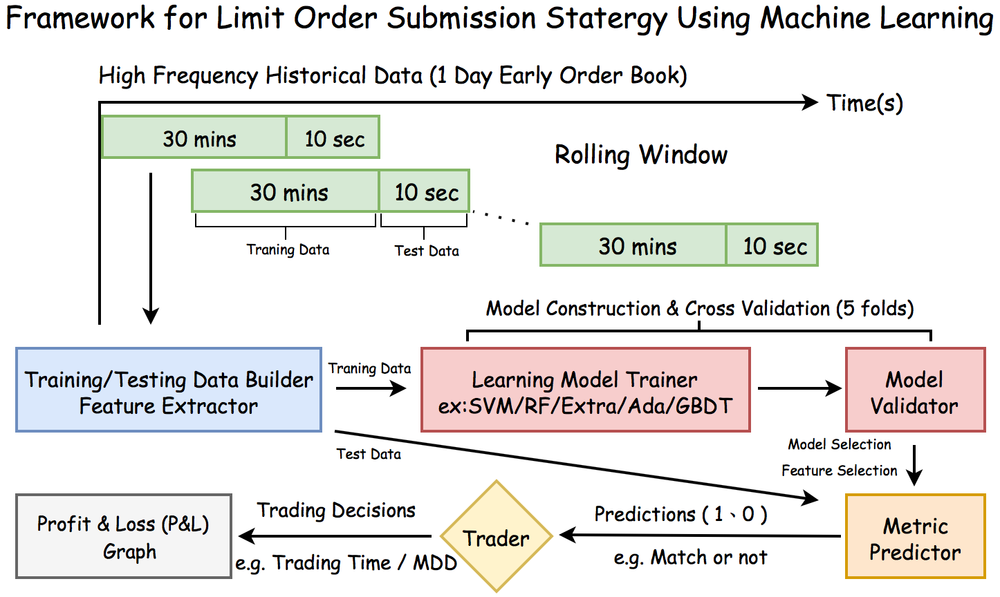
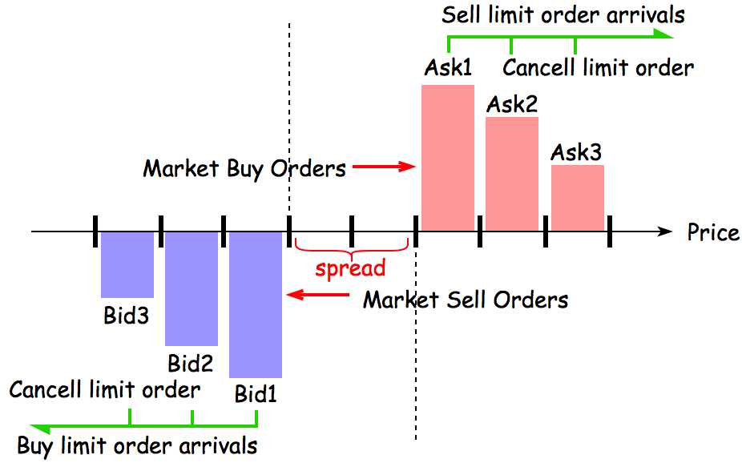
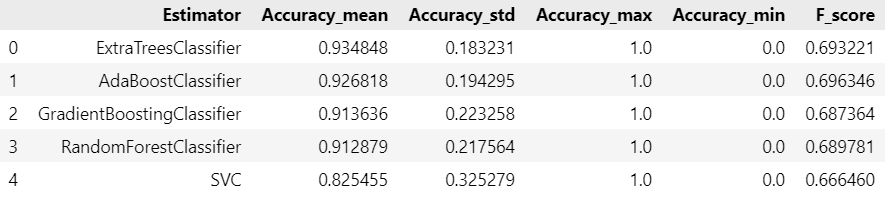
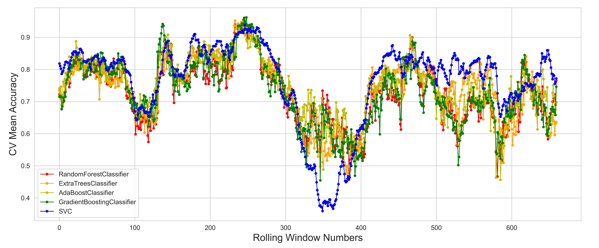

# Machine Learning for High-Frequency Trading

A machine learning framework for analyzing Level-II limit order book data, engineering market microstructure features, predicting short-term market dynamics, and visualizing trading performance.

**Author:** Tanvi Nagar  
**Repository:** [ml-high-frequency-trading](https://github.com/tanvi2594/ml-high-frequency-trading)

## Overview

High-frequency trading (HFT) relies on granular market data, rapid signal extraction, and systematic evaluation of trading decisions. This project explores how machine learning can be applied to order book data to identify predictive signals and study market behavior.

The framework covers data processing, feature engineering, model training, prediction analysis, and P&L visualization.

## Key Components

- **Order Book Analysis:** Analyze Level-II market depth, bid-ask prices, and quantities.
- **Feature Engineering:** Explore Order Book Imbalance (OBI), depth ratios, and rise ratios as potential predictive signals.
- **Machine Learning:** Evaluate baseline classifiers, including Random Forest, Extra Trees, AdaBoost, Gradient Boosting, and Support Vector Machines.
- **Model Evaluation:** Examine prediction accuracy and cross-validation results.
- **Trading Performance Visualization:** Explore prediction outputs and profit-and-loss visualizations.

## Project Pipeline

1. Load and inspect tick-level market data.
2. Process order book information and prepare features.
3. Construct market microstructure signals.
4. Train and evaluate predictive models.
5. Analyze model predictions and visualize results.



## Dataset

The project includes sample tick-level depth data for SGX FTSE China A50 Index Futures.

The included datasets are historical examples, not live market feeds. Check the original dataset's redistribution terms before sharing it publicly.

## Feature Engineering

The framework explores several order book signals:

- **Order Book Imbalance (OBI):** Measures the relative imbalance between bid-side and ask-side quantities.
- **Depth Ratio:** Examines the distribution of liquidity across the order book.
- **Rise Ratio:** Explores price-related changes as a potential predictive feature.

These features can help investigate short-term market dynamics, but their predictive value must be validated empirically.



## Models and Evaluation

The original framework explores baseline classification methods such as:

- Random Forest
- Extra Trees
- AdaBoost
- Gradient Boosting
- Support Vector Machines

The notebooks also include prediction analysis, cross-validation visualizations, and model comparison.





**Note:** Reported predictive accuracy does not, by itself, establish profitability. A rigorous trading evaluation should account for transaction fees, slippage, market impact, latency, and look-ahead bias.

## Repository Structure

```text
ml-high-frequency-trading/
├── Graph/
├── images/
├── data/
├── HFT_factors.ipynb
├── data_process.ipynb
├── data_visualization.ipynb
├── feature_engineering.ipynb
├── model_fitting.ipynb
└── README.md
```

## Getting Started

### Requirements

- Python 3
- Jupyter Notebook
- pandas
- NumPy
- Matplotlib
- scikit-learn

Additional dependencies may be needed depending on the notebook cells you execute.

### Setup

Clone the repository:

```bash
git clone https://github.com/tanvi2594/ml-high-frequency-trading.git
cd ml-high-frequency-trading
```

Create a virtual environment:

```bash
python -m venv .venv
```

Activate it on Windows:

```powershell
.\.venv\Scripts\Activate.ps1
```

Install the core dependencies:

```bash
python -m pip install pandas numpy matplotlib scikit-learn jupyter
```

Launch Jupyter Notebook:

```bash
jupyter notebook
```

Start with `data_process.ipynb`, followed by the feature engineering, visualization, and model-fitting notebooks. Exact execution order may depend on the variables and files referenced by individual notebooks.

## My Contribution and Learning Focus

As an IIT Delhi Production and Industrial Engineering student interested in machine learning and quantitative finance, my focus with this repository is to:

- Study how order book structure can be translated into quantitative features for predictive modeling.
- Understand the complete workflow from historical market data to feature engineering, model evaluation, and trading analysis.
- Improve the clarity of project documentation and reproducibility of the experimental workflow.
- Identify opportunities for more rigorous out-of-sample evaluation and realistic transaction-cost-aware backtesting.

These points describe my focus and intended extensions, not a claim that every improvement has already been implemented. Any original implementation, reproduced results, or additional experiments will be identified separately as they are completed.

## Future Improvements

- Add time-aware validation and walk-forward evaluation.
- Investigate stronger models and additional market microstructure features.
- Evaluate directional accuracy alongside precision, recall, and other appropriate metrics.
- Incorporate transaction costs and slippage into backtesting.
- Assess robustness across different market periods and regimes.


## Disclaimer

This project is for educational and research purposes. It is not financial advice, and the results do not guarantee future trading performance.

---
